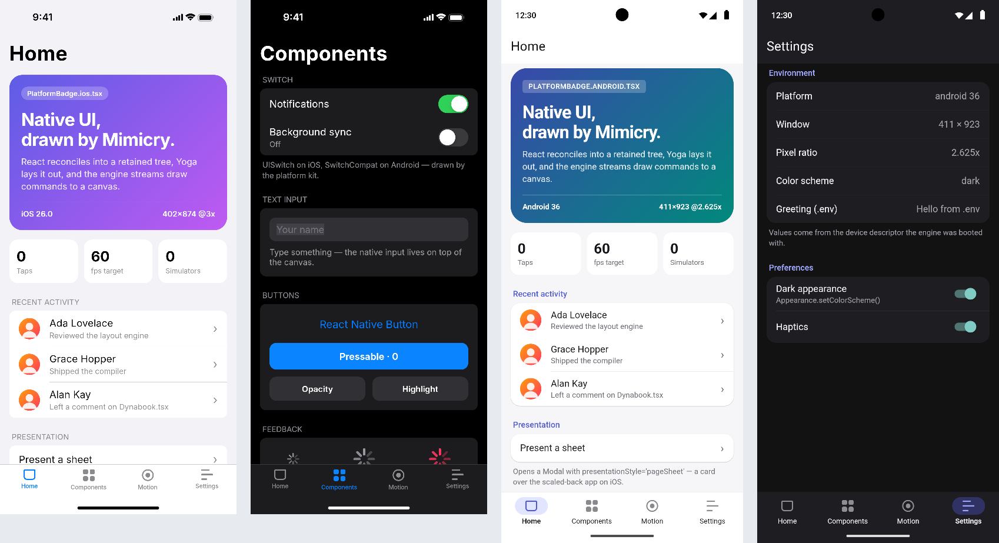

# Mimicry

**A browser-native simulator for React Native apps.** Mimicry runs your Expo / React Native app in a browser tab and draws it as an iPhone or an Android phone. It needs no Mac, Xcode, Android Studio or VM.

Mimicry takes the architecture [Dactyl](https://dactyl.dev/blog/how-dactyl-works/) built for SwiftUI and applies it to React Native:

- A **reimplementation of the platform**, not a stream from a real simulator. React reconciles into a retained view tree. [Yoga](https://yogalayout.dev) (the layout engine React Native ships on device) lays it out, and platform kits draw UIKit- or Android-style controls.
- A **binary draw-command stream**. Layout and text are fully resolved before a single command is written. A thin host paints the stream on Canvas2D and caches each chunk's raster by content hash, so scrolling and transform or opacity animations cost compositing, not painting.
- A **base/side module split**. The engine, React and `react-native` form one content-addressed base module that the browser loads once. Your app compiles per file into a small side module, and edits hot-swap under the running app with Fast Refresh, so state survives.
- **Native controls at resolved rectangles.** Like Dactyl's Compose host mounting real Material widgets, the browser host mounts real `<input>`s exactly where the engine laid out each `TextInput`, so IME, selection and autofill are native.
- **A deterministic test loop.** The same engine runs headless in Node on a virtual clock, which gives you golden images, filmstrips with synthetic taps, and layout-tree diffs. Real simulator screenshots are used only as an offline oracle.

```
App.tsx ──compile──▶ side module ──link──▶ base module (Web Worker)
                                            React → retained tree → Yoga → platform kit
                                                        │ binary frame (chunks + layers + overlays)
                                                        ▼
                                            host: Canvas2D compositor + raster cache + native inputs
```



## Quick start

Requires Node 22.13+.

```sh
git clone https://github.com/Fausto95/mimicry.git
cd mimicry
npm install
npm run dev            # Studio for examples/showcase at http://127.0.0.1:5173
```

To point it at your own app (a classic Expo entry: `index.ts` with `registerRootComponent`, or `App.tsx`):

```sh
node packages/cli/bin/mimicry.js dev path/to/your-app
```

You don't need to add anything to the app. `react-native`, `react`, `expo`, `expo-status-bar`, `react-native-safe-area-context` and `expo-linear-gradient` come from the base module. Other packages are prebundled with esbuild.

## What the Studio gives you

- Switch iOS ↔ Android (each platform compiles its own module graph, so `*.ios.tsx` and `*.android.tsx` resolve like Metro), change devices (iPhone 17 Pro, 16e, SE, iPad Air, Pixel 9, Galaxy S25, Pixel Tablet), toggle light/dark, rotate, use Android back, slow animations 10×, and take device-resolution screenshots.
- **Inspect**: the React component tree with host types and test IDs. Hover a row to outline the element on the device, or pick an element on screen.
- **Engine**: per-frame layout and encode time, raster time, chunk cache hit rate, composited layers, frame stream size.
- **Logs**: the app's console output, build errors and runtime errors. Render errors also appear in the device as a LogBox-style screen.

## Headless testing

```ts
import { launch } from '@mimicry/testing';

const { session } = await launch('examples/showcase', { device: 'pixel-9', appearance: 'dark' });
session.tap({ testID: 'tab-motion' });
session.scroll({ testID: 'motion-scroll' }, { dy: 300 }).settle();
const png = session.screenshot();              // device resolution, deterministic
const frames = session.filmstrip({ duration: 600, every: 100 });
const tree = session.layout();                 // compact layout tree for snapshot diffs
```

From the command line:

```sh
mimicry render examples/showcase --scene examples/showcase/scenes/components-dark.json --out shot.png
mimicry filmstrip examples/showcase --scene examples/showcase/scenes/spring.json --out film/
mimicry oracle examples/showcase --scenes examples/showcase/scenes --reference oracle/ios --out report/
mimicry diff a.png b.png --out diff.png
```

`scripts/capture-oracle.mjs` captures the reference screenshots on a real iOS Simulator (macOS) from the same scene files.

## Repository layout

| Package | Role |
| --- | --- |
| `@mimicry/protocol` | Frame format, opcodes, writer/reader, engine↔host messages, device descriptors |
| `@mimicry/engine` | React host config, retained tree, Yoga layout, text layout, platform kits, painter, input, scroll physics |
| `@mimicry/react-native` | The `react-native` API surface (components, Animated, Alert, …) plus Expo/community shims |
| `@mimicry/runtime` | Module linker with Fast Refresh, app runtime, the engine Web Worker entry (base module) |
| `@mimicry/host-web` | Canvas2D executor + compositor with raster cache, native input overlays, `EngineHost` |
| `@mimicry/compiler` | Base module build, per-file side module compiler (SWC), resolver, vendor prebundle |
| `@mimicry/studio` | The browser UI around the device |
| `@mimicry/cli` | `mimicry dev / render / filmstrip / oracle / diff` and the dev server |
| `@mimicry/testing` | Headless sessions, filmstrips, pixel diffs |

Read more in [docs/architecture.md](docs/architecture.md), [docs/protocol.md](docs/protocol.md) and [docs/fidelity.md](docs/fidelity.md).

## Development

```sh
npm test               # unit, e2e, golden and filmstrip tests (Vitest)
npm run typecheck
npm run goldens:update # after an intentional visual change
npm run test:browser   # Studio smoke test in Chromium (needs `npm run dev` on :5180, see the file)
```

## Status

Alpha. It renders and runs real Expo apps built from core React Native components, with both platform kits, Animated, scrolling, modals, alerts and Fast Refresh. The fidelity table in [docs/fidelity.md](docs/fidelity.md) lists what is approximate and what is missing (virtualized lists, sticky headers, multi-touch, inline views in text, native modules, expo-router, among others).

License: not yet selected.
