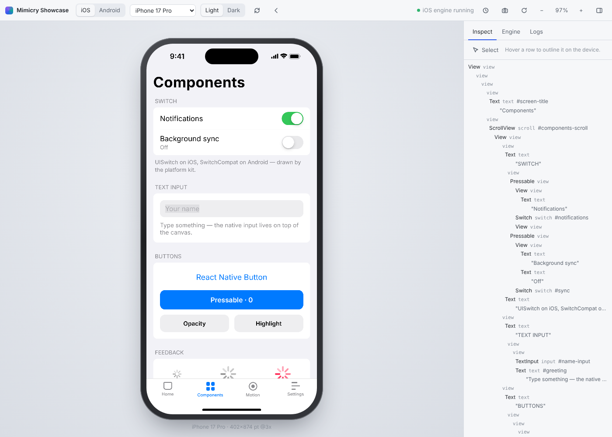

# Architecture

Mimicry reimplements the parts of iOS and Android that a React Native app touches, runs them in a Web Worker, and streams pixels-to-be as binary draw commands to a thin host. The simulator is never in the loop at runtime.



## The pipeline

```
                ┌──────────────────────── dev server (Node) ────────────────────────┐
  app source ──▶│ compiler: resolve (.ios/.android/.native), SWC → CJS + Refresh,   │
                │ assets, EXPO_PUBLIC_*, vendor prebundle (esbuild)                 │──▶ side module (JSON records)
                │ base: engine + React + react-native + runtime → base.<hash>.js    │──▶ base module (immutable)
                └───────────────────────────────────────────────────────────────────┘
                                         │ SSE: hot updates
┌──────────── Web Worker: base module ────────────┐        ┌──────────── page: host ─────────────┐
│ module linker ─▶ app modules ─▶ React           │        │ Studio UI                           │
│ reconciler (mutation) ─▶ retained HostNode tree │ frame  │ decode frame                        │
│ Yoga (pixel grid, RN errata) ─▶ text layout     │──────▶ │ composite layers, raster chunks     │
│ platform kit (UIKit / Android) ─▶ painter       │ (bin)  │   by content hash (LRU cache)       │
│ input: hit test, responder system, scroll       │◀────── │ native <input>s at overlay rects    │
│ animator: Animated, springs, momentum, spinners │ input  │ pointer / wheel / keys → engine     │
└─────────────────────────────────────────────────┘        └─────────────────────────────────────┘
```

The engine has no DOM dependency. In Node, the same engine runs in-process on a `VirtualClock`, and the same compositor paints into `@napi-rs/canvas` with the same font files. That parity is what makes headless screenshots trustworthy.

## Engine

**Retained tree.** `@mimicry/engine` is a `react-reconciler` host config in mutation mode. Every host element (`m-view`, `m-text`, `m-scroll`, `m-input`, `m-switch`, …) becomes a `HostNode` that owns a Yoga node, its last frame, and native behavior state (scroll offset, switch transition, ripple, modal presentation). Raw text outside `<Text>` throws React Native's own error. Nested `<Text>` becomes attributed spans, not boxes.

**Layout.** Yoga is configured like React Native's: point scale factor = device scale (layout snaps to physical pixels), non-web defaults, and compatibility errata (so, for example, absolute children respect the parent's padding, as on device). Layout runs in `resetAfterCommit`, before layout effects, so `ref.measure()` in `useLayoutEffect` sees real geometry, matching Fabric. `onLayout` fires afterwards.

**Text** is laid out by the engine: tokenization (with CJK break opportunities), greedy wrapping, character breaking for long words, `numberOfLines` with head/tail ellipsis, mixed fonts per line, and line height centering. Hosts only ever draw pre-positioned single-line runs. Measurement goes through a `TextMeasurer`: an `OffscreenCanvas` in the worker, `@napi-rs/canvas` in Node.

**Platform kits** (`platform/ios.ts`, `platform/android.ts`) hold everything that differs once layout is done: font stacks, `PlatformColor` tables (UIKit semantic colors, Android theme attributes), how native controls draw, the status bar (and, on iOS, the Dynamic Island, which appears in screenshots), scroll physics constants, and behavioral switches. For example, iOS draws a uniform border above subviews while Android draws it in the background, and iOS hit-tests children outside their parent while Android doesn't. Kits are mostly data, so the fidelity loop edits tables, not engine code.

**Painter.** The painter walks the laid-out tree. A node becomes its own composited layer when it has a transform, group opacity, or moves independently of its parent (scroll content, scroll indicators, presented modals, system chrome). Everything else is recorded as self-contained *items* into the enclosing layer's *segments*. Each segment becomes one *chunk*, or a grid of 1024-px tiles when it is large and its visible region is known (scroll content). Chunks are hashed by bytes and bounds.

**Input.** Pointer events are hit-tested in paint order (zIndex, Android elevation, `pointerEvents`, `hitSlop`, transforms, scroll offsets, clipping). Taps on nested text resolve to the span's node. The Gesture Responder System runs as on device: capture/bubble negotiation, grant, move, termination requests, release. Scroll views are native: past the touch slop they take the gesture and terminate the JS responder, which cancels a press inside a list exactly like a `UIScrollView` does.

**Safe areas** follow UIKit's model (`layout/safe-area.ts`). The window's insets come from the device descriptor; containers add their own with `additionalSafeAreaInsets` — a tab bar controller its tab bar, a navigation controller its bar — and a view's insets are where its frame overlaps the unsafe region around its nearest container. Views that pad themselves by their insets (`SafeAreaView` from react-native-safe-area-context, RNSSafeAreaView) are resolved inside layout with an extra Yoga pass, so there is no first frame with the wrong padding. Scroll views with `contentInsetAdjustmentBehavior` adjust their content inset the same way.

**Gestures.** `input/gestures/` implements react-native-gesture-handler's model in the engine: recognizers attached to host nodes (pan, tap, long press, fling, pinch, rotation, native, manual) run RNGH's state machine in an arena that applies simultaneous / require-to-fail / blocks relations. An activating gesture claims the touch and cancels the JS responder and other gestures; a scroll view starting to drag is its native gesture activating.

**Animation.** Everything that "reads something live this frame" registers with the `Animator`: Animated values, scroll momentum and rubber banding, switch transitions, spinners, ripples and modal presentation. Animated writes resolved values straight onto host nodes as style overrides, which behaves like `useNativeDriver: true` for every animation, so React doesn't re-render per frame. When nothing is live, the engine stops requesting frames.

## Libraries: their JavaScript, Mimicry's native side

Real apps are mostly libraries. Mimicry runs each library's own published JavaScript (prebundled from the app's `node_modules`) and implements what that JavaScript expects from the platform:

```
 app code ─▶ expo-router ─▶ @react-navigation/native-stack ─▶ react-native-screens (JS)
                                                                 │ codegenNativeComponent('RNSScreenStack')
                                                                 ▼
                          @mimicry/react-native  native/registry ─▶ native/screens/stack.tsx
 expo-constants (JS) ── requireNativeModule('ExponentConstants') ─▶ native/expo-modules.ts
```

- **Native components** (`codegenNativeComponent`, `requireNativeComponent`, Expo's `requireNativeView`) resolve through `native/registry.ts` to React components written against Mimicry's primitives and engine: react-native-screens' stack, screens, navigation bars and tabs; react-native-svg's RNSVG* elements (engine `m-svg` nodes painted by `engine/src/svg`); expo-image, expo-symbols, expo-blur and expo-glass-effect. An unknown native view renders its children in a plain view and logs one warning.
- **Native modules** (`TurboModuleRegistry`, `NativeModules`, Expo's `requireNativeModule`) are plain objects: Constants from the resolved app config, Device from the device descriptor, SplashScreen, FontLoader (custom fonts reach the worker, the host canvas and headless Node), Linking, WebBrowser, SystemUI and others. `expo-modules-core` itself is implemented natively.
- **Libraries whose native half is the point** — Reanimated (JSI worklets), react-native-worklets and Gesture Handler — are provided modules reimplemented on the engine: shared values and animations run on the engine's frame clock and write styles onto host nodes like the native driver; layout animations keep exiting nodes painted until they finish (`tree/exit.ts`).
- The compiler supplies what Metro would: expo-router's `require.context` over the app directory, `react-native/Libraries/…` deep imports, Flow stripping, assets registered with numeric ids, CSS as empty modules, and the app config.

## Frame loop

1. A React commit, an input event or an animation calls `requestFrame()`. The engine sends one `requestFrame` message.
2. The host's `requestAnimationFrame` replies with `frame(time)`. The host's vsync is the clock.
3. The engine runs app `requestAnimationFrame` callbacks and steps animations, scroll physics, `onScroll` and `Animated.event`, all in the same frame. It runs Yoga if anything is dirty, paints, and transfers the frame buffer.
4. The host composites. Chunks with known hashes are drawn from cached rasters, new ones are rasterized once. Native inputs are re-synced to their rectangles.

## Base and side modules

| | Base module | Side module |
| --- | --- | --- |
| Contains | engine, React (dev), react-reconciler, react-refresh, Yoga (wasm), `react-native`, shims, linker | the app's files, one CommonJS record per file, plus a vendor bundle for third-party packages |
| Built by | esbuild, once per server start | SWC per file, cached by mtime |
| Identity | `base.<sha256>.js`, served immutable | records with dependency maps |
| On edit | untouched | changed records only, over SSE |

Each side-module record carries a dependency map (`'./Button' → 'src/Button.ios.tsx'`, `'react-native' → 'provided:react-native'`), so linking is a table lookup. Like Dactyl binding a side module's imports to the base's exports, `provided:*` resolves to the base's own instances: one React, one `react-native`. A hot update re-executes the changed modules up to the nearest React Refresh boundary, then `performReactRefresh()` swaps component implementations under the running tree with hook state preserved. If an update reaches the entry with no boundary, the app reloads. A successful refresh after an error dismisses the RedBox, as React Native does.

Switching between iOS and Android re-boots the worker with the other platform's module graph, because `*.ios.tsx` and `*.android.tsx` are different programs. Device, orientation and appearance changes are live.

## Testing loop

- **Headless sessions** (`@mimicry/testing`): `render(<App/>)` or `launch(projectDir)` on a virtual clock. Use `tap`, `drag`, `scroll`, `type`, `back` and `setEnvironment` to drive the app, `advance` and `settle` to move time, `screenshot` (device resolution) to capture, `layout()` for tree dumps, and `filmstrip()` for frame sequences with timed actions. Same inputs give the same pixels.
- **Goldens** (`tests/golden`) cover iOS, Android and iPad in light and dark.
- **Oracle** (`mimicry oracle`): renders scene files and diffs them against screenshots captured on real simulators and emulators by `scripts/capture-oracle.mjs`, then writes an HTML report. This is the Dactyl development loop: render, diff against the platform, fix the kit, repeat. `.github/workflows/oracle.yml` runs it for every example on an iOS simulator (macOS runner) and an Android emulator (Linux, KVM).
- **Motion oracle** (`mimicry oracle --motion`): `scripts/capture-motion.mjs` screen-records a scene's trigger on the device; Mimicry replays it at 60 fps on the virtual clock; both recordings are reduced to progress curves (how far each frame is from the motion's start to its end), which compares easing and timing independently of how the pixels look.
- Callbacks React Native delivers asynchronously (onLayout, cached image loads) go through `engine.defer()`: a microtask in the browser, drained inside `act()` by headless sessions so they land on virtual time.
